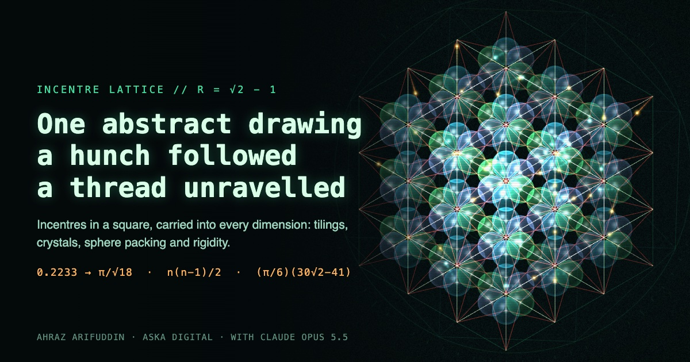
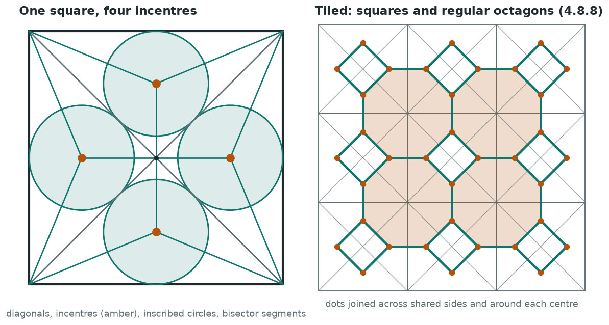
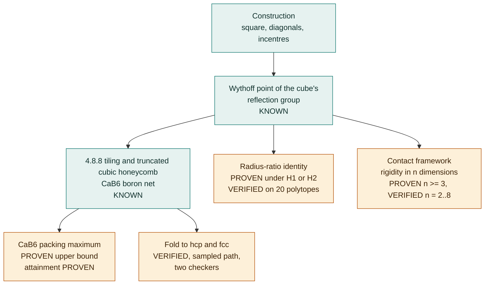
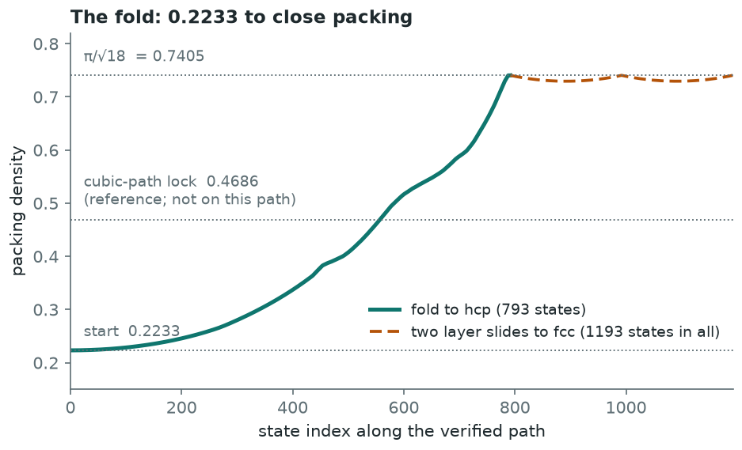
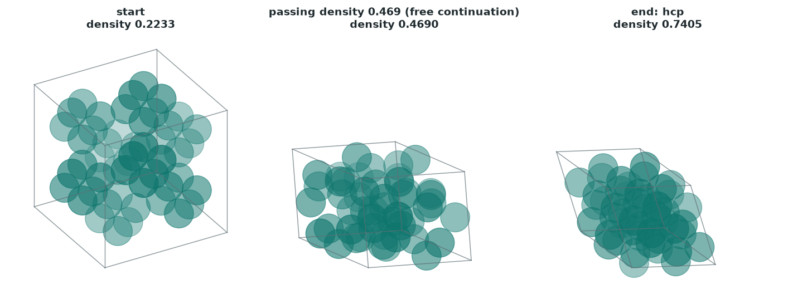
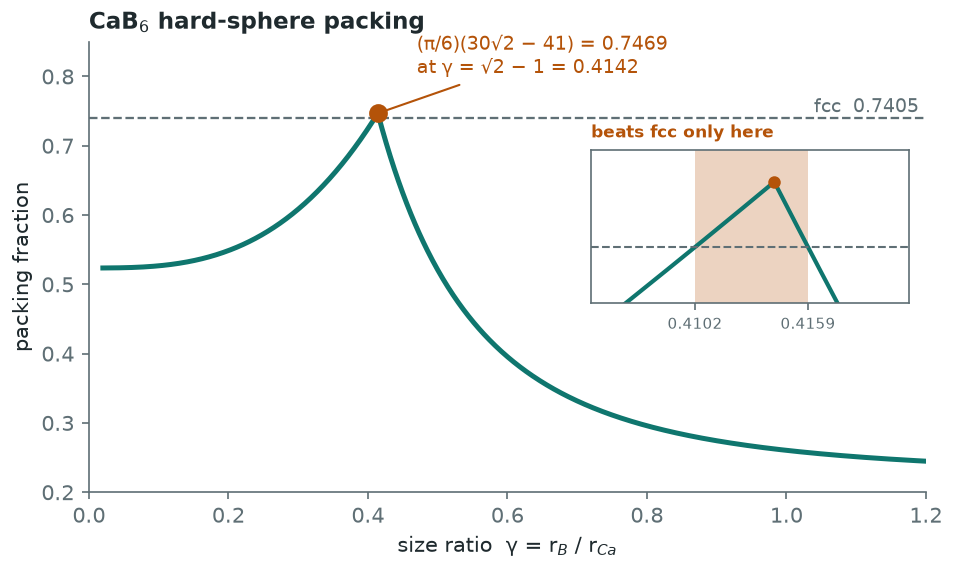
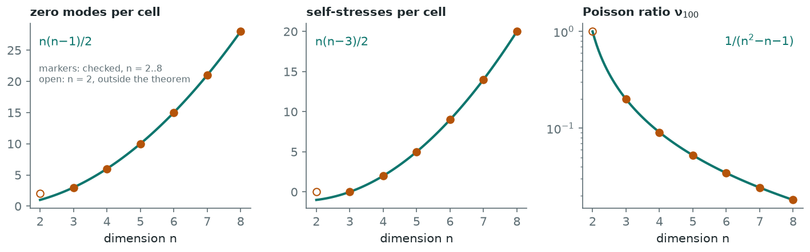
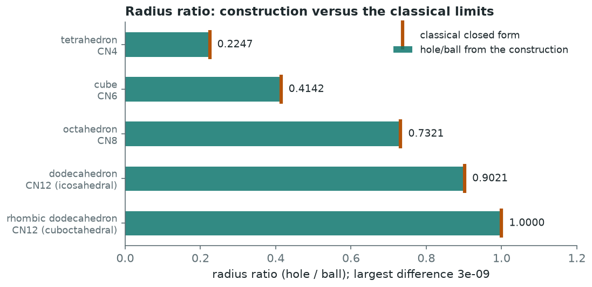

# Incentre lattice

[](https://doi.org/10.5281/zenodo.23322079)



One abstract drawing, a hunch followed, a thread unravelled. (Where the drawing came from is told on the Drift page, `drift.html`.)

Draw a square and its two diagonals. In each of the four triangles, mark the point that is the same distance from all three sides, and join it to the triangle's corners. That one rule, carried into a cube and then into any number of dimensions, lands on uniform honeycombs, on the radius-ratio limits of chemistry, on the boron framework of calcium hexaboride, and on a framework whose rigidity has a closed form in every dimension.

<picture>
  <source media="(prefers-color-scheme: dark)" srcset="docs/img/construction-dark.png">
  
</picture>

This repository is an open, agent-assisted research project around that construction. It holds:

- **An interactive site** ([live on GitHub Pages](https://aska-digital.github.io/incentre-lattice/)). Explore the drawing, mirror geometry, chemistry, folding mechanics, perception, and a ledger of claims with evidence labels. The [research update](https://aska-digital.github.io/incentre-lattice/research.html) presents the explicit continuous fcc motion, literature correction, assessment and open review work.
- **Research notes** in `research/`, with the code behind every number.
- **Open tracks** in `tracks/`: questions with a fixed, trusted checker and a single score, so that people and AI agents can attack them in parallel. See [CONTRIBUTING.md](CONTRIBUTING.md).

## What is known and what is ours



How the pieces connect. Teal boxes are classical or the construction itself; amber boxes are the results of this project. Evidence labels as in the ledger (`open.html`).

Most of the geometry is classical. The dot is the Wythoff point of the cube's reflection group (Wythoff 1918, Coxeter), its orbit is the truncated square tiling in 2D and the truncated cubic honeycomb in 3D, the 3D arrangement is Pauling and Weinbaum's CaB6 boron net (RCSR `cab`), and the 2D fold is a known hinged tiling (Flores, after Stuart 1963). The bridged cross-polytope framework itself is prior art: Borcea and Streinu 2021, Section 7, describe the same periodic graph (two orbits of regular cross-polytopes, 2d bars per body, any d), with bars twice the cross-polytope edge, that is dots at t = sqrt2 - 1 where ours sit at 2 - sqrt2. Our counts hold for any 0 < t < 1, so they cover it. Section 7 gives only the 3D count and a 3D folding sketch to a folded state, not a packing. The n-dimensional mode and self-stress counts are likely routine with existing machinery (priority unresolved). The strongest remaining candidate is the unit-spring result C11/C12 = (n-1)^2 and nu_100 = 1/(n^2-n-1), not found in Borcea and Streinu Section 7 or in Goodwin's abstract. The other results we have not found in print, after web searches only, are: a single radius-ratio identity, and the closed form of the CaB6 hard-sphere packing maximum (its location, gamma = sqrt2 - 1, may already be known from Travesset 2017, which could not be read). The fold of the 3D framework to close packing (0.2233 to π/√18 in hcp, 2×2×2 family, two checkers) is the other result; no prior description was found (searches listed in `autoresearch-fold/`). The corner-sharing version is textbook: in ReO3, rotating the octahedra alone reaches hcp at 30 degrees about <111> (Johnsson & Lemmens 2006; Shan et al., under pressure; O'Keeffe & Hyde 1977). In the cab framework, where octahedra are joined by bars, the cubic tilt stalls at density 0.4686 (0.2637 at 30 degrees), and reaching close packing needs a symmetry-breaking continuation with lattice shear. Only that cab result is "not found". The closest physical study of the cab framework's flexibility is Li, Refson & Dove 2023 (CaB6 rigid unit modes). Two rigid layer slides then reach fcc (accepted by two independent checkers). This is a geometry result, not a predicted phase transition in real CaB6 or Prussian-blue materials. The ledger page (`open.html`) labels every claim as PROVEN, VERIFIED NUMERICALLY, CONJECTURE or KNOWN.

Nothing here has been peer reviewed.

**October 2026 update:** the site now distinguishes the established results on `main` from the proposals in [PR #23](https://github.com/aska-digital/incentre-lattice/pull/23), [#25](https://github.com/aska-digital/incentre-lattice/pull/25), [#27](https://github.com/aska-digital/incentre-lattice/pull/27), [#28](https://github.com/aska-digital/incentre-lattice/pull/28) and [#29](https://github.com/aska-digital/incentre-lattice/pull/29). These include an explicit all-parameter fcc motion and a focused paper. Bridged cross-polytopes in arbitrary dimensions are a known framework family; historical priority of the specific formulas and motion remains unresolved. See the [research update](https://aska-digital.github.io/incentre-lattice/research.html) for the evidence and source-access limits.

## Paper

Preprint, version 2 (not peer reviewed): **The bridged cross-polytope framework: unit-spring elastic constants in every dimension and an exact motion from the CaB<sub>6</sub> boron net to face-centred cubic packing**, Ahraz Arifuddin (Aska Digital), 2026. [PDF](papers/incentre-lattice.pdf) · [LaTeX source](papers/source/) · DOI: v2 is [10.5281/zenodo.23340326](https://doi.org/10.5281/zenodo.23340326) (all versions: [10.5281/zenodo.23322079](https://doi.org/10.5281/zenodo.23322079)).

The headline results are the unit-spring elastic constants in every dimension n >= 3 (all shear moduli zero, C11/C12 = (n-1)^2, nu_100 = 1/(n^2-n-1)) and the exact cab-to-fcc motion of [`results/fold-continuous-fcc`](results/fold-continuous-fcc/PROOF.md), now with a written symmetry-reduced non-overlap proof ([HAND-PROOF.md](results/fold-continuous-fcc/HAND-PROOF.md)). The zero-mode and self-stress counts are lemmas: the same periodic graph is in Borcea and Streinu (2021), Section 7.

Version 1, **The incentre of the centre-cut pyramid: rigidity of the truncated n-cubic contact framework, a radius-ratio identity, and the CaB<sub>6</sub> packing maximum**, is kept unchanged as [papers/incentre-lattice-v1.pdf](papers/incentre-lattice-v1.pdf), DOI [10.5281/zenodo.23322080](https://doi.org/10.5281/zenodo.23322080). Its novelty claims for the rigidity counts are corrected in v2. The v1 PDF's SHA-256 hash is recorded in the public commitment (see below).

## Results

Every result below has a folder in `results/` with a `PROOF.md` (statement, scope, evidence label, proof, prior art, open obligations), a deterministic `verify.py`, and a
`certificate.json`. Labels: **PROVEN** = written proof; **VERIFIED** = finite check, not a proof; **KNOWN** = published and cited. Prior-art entries mean "not found in the
searches listed", not "new".

### Results at a glance

Every value drawn below is read from the committed certificates and path files, or evaluated from a closed form (the CaB6 curve by `phi_closed()` in [`results/cab6-packing/cab6_packing.py`](results/cab6-packing/cab6_packing.py); the rigidity formula curves, the classical radius-ratio limits, the reference lines pi/sqrt18 and cubic-path lock, and the construction geometry in the script itself), by [`docs/img/make_readme_figures.py`](docs/img/make_readme_figures.py) (`pip install -r requirements-dev.txt`, then run the script). The plotted values are reproducible; the PNG bytes also depend on the font and freetype build, so a regenerated image may differ slightly in size or anti-aliasing.

<picture>
  <source media="(prefers-color-scheme: dark)" srcset="docs/img/fold-density-dark.png">
  
</picture>

<picture>
  <source media="(prefers-color-scheme: dark)" srcset="docs/img/fold-frames-dark.png">
  
</picture>

<picture>
  <source media="(prefers-color-scheme: dark)" srcset="docs/img/cab6-packing-dark.png">
  
</picture>

<picture>
  <source media="(prefers-color-scheme: dark)" srcset="docs/img/rigidity-dark.png">
  
</picture>

<picture>
  <source media="(prefers-color-scheme: dark)" srcset="docs/img/radius-ratio-dark.png">
  
</picture>

### Results table

| Result | Value | Label | Verify | Prior art |
|---|---|---|---|---|
| [n-dimensional rigidity](results/rigidity-nd/PROOF.md) | generic zero modes n(n-1)/2, self-stresses n(n-3)/2 per cell; nu_100 = 1/(n^2-n-1); shear moduli 0 | PROVEN n >= 3; VERIFIED n = 2..8 | `make verify-rigidity` | same framework as Borcea and Streinu 2021 Section 7 (their bars are at t = sqrt2 - 1, ours at 2 - sqrt2; counts hold for any 0 < t < 1); n-D counts likely routine, priority unresolved; C11/C12 = (n-1)^2 and nu_100 = 1/(n^2-n-1) are the strongest remaining candidate. Goodwin 2006 studied the same topology's rigid unit modes (abstract only read) |
| [Radius ratio](results/radius-ratio/PROOF.md) | hole/ball of the dot construction = classical radius ratio, under mirror walls or insphere plus equal dihedral angles | PROVEN under H1 or H2; VERIFIED on 20 polytopes | `make verify-radius-ratio` | not found as a statement; ingredients known |
| [CaB6 packing](results/cab6-packing/PROOF.md) | maximum (pi/6)(30 sqrt2 - 41) = 0.746865 at gamma = sqrt2 - 1; beats fcc for 0.41023 < gamma < 0.41591 | PROVEN upper bound; attainment PROVEN ([ATTAINMENT.md](results/cab6-packing/ATTAINMENT.md)), finite check corroborates | `make verify-cab6` | curve plotted by Horst and Travesset 2016; location of the peak possibly in Travesset 2017 (not read); closed form not found, not confirmed new |
| [2D fold](results/fold-2d/PROOF.md) | density 0.5390 to pi/4 at theta = pi/4 | KNOWN linkage (Flores; Stuart); corollaries PROVEN | `make verify-fold2d` | known mechanism |
| [3D fold, cubic-restricted](results/fold-3d-cubic/PROOF.md) | 27 pi sqrt2/256 = 0.4686 at 60 degrees; a lock of the cubic path, not a jam | VERIFIED | `make verify-fold3d` | Prussian-blue tilts known; end net matches RCSR sms (ten terms) |
| [Fold to close packing](results/fold-close-packing/PROOF.md) | pi/sqrt18 = 0.74048: sampled bar-preserving, overlap-free path in the 2x2x2 supercell to hcp (793 states) and fcc (1193 states) | VERIFIED (sampled continuity, step <= 0.01; two checkers); fcc extension is new work | `make verify-fold-cp` | cab result not found; corner-sharing ReO3 to hcp by rotation alone is KNOWN (Johnsson and Lemmens 2006; Shan et al.; O'Keeffe and Hyde 1977) |
| [Exact fold end states](results/fold-end-exact/PROOF.md) | the hcp and fcc end states of the m = 2 paths in closed form: every coordinate an integer multiple of (2 - sqrt2)/3 | PROVEN (integer arithmetic); match to the stored paths VERIFIED to 1e-7 | `make verify-fold-exact` | not searched separately (see the fold row) |
| [Fold at m = 1](results/fold-m1/PROOF.md) | one octahedron per cell (6 balls) folds to hcp (free descent, 333 states) and to fcc (268 states, density rising at every sample) | VERIFIED (sampled continuity; two checkers); end states PROVEN exact; new work | `make verify-fold-m1` | not searched separately (see the fold row) |
| [Continuous fold to fcc](results/fold-continuous-fcc/PROOF.md) | explicit smooth m = 1 motion; every bar and all-pairs non-overlap; density strictly increases to pi/sqrt18 | PROVEN (written argument and exact Bernstein certificate); internal review, human review pending | `make verify-fold-continuous` | related frameworks known; exact-motion priority unresolved |

The smallest cell (m = 1, one octahedron) also reaches close packing, to hcp and to fcc (`results/fold-m1`). A separate [explicit fcc motion](results/fold-continuous-fcc/PROOF.md) now has an exact all-parameter certificate; the stored numerical paths retain their sampled-continuity labels. The fold is a geometry and rigidity result, not a predicted phase transition of real CaB6 or Prussian-blue materials.

## Reproduce

```
python3 -m venv .venv && . .venv/bin/activate
pip install -r requirements.txt
make verify          # about 4 to 6 minutes; make verify-fast for the quick targets
```

`make verify` reruns every verifier, including must-fail controls, and the CI matrix (Python 3.11, 3.12, 3.13) fails if a regenerated certificate differs from the committed one.
See [docs/reproducibility.md](docs/reproducibility.md), [docs/audit.md](docs/audit.md) (what each check does and does not show), [docs/status.md](docs/status.md) (current best
per track), [docs/review-ledger.md](docs/review-ledger.md) (reviews so far; internal only) and [docs/formalization.md](docs/formalization.md) (Lean targets, open).

## Certificates and commitment

`certificates/selected-results.json` has one record per result (statement, value, label, verifier command, input hashes); `certificates/SHA256SUMS` lists every certificate and path
file; `commitment/` holds a SHA-256 manifest and its root hash, with instructions to check it ([commitment/README.md](commitment/README.md)). The commitment was posted publicly on 2026-10-12 ([gist](https://gist.github.com/ahrazzle/46adf76f15bf766e24b8df626f9c5706)).

## Credit, notices, citation

[CONTRIBUTORS.md](CONTRIBUTORS.md) (including AI assistance and which models did which roles), [NOTICE](NOTICE) (third-party data and licences; note the mixed licences of the
COD extracts), [CITATION.cff](CITATION.cff) (cites the preprint). Pull requests use `.github/pull_request_template.md`; reviews use the "Research review" issue template.

## Licence

Code: MIT. Text, figures and site content: CC BY 4.0. Credit: [@ahrazzle](https://github.com/ahrazzle) (Ahraz Arifuddin), [@aska-digital](https://github.com/aska-digital) (Aska Digital) and [@claude](https://github.com/claude) (Claude Opus 5.5 from Anthropic).
